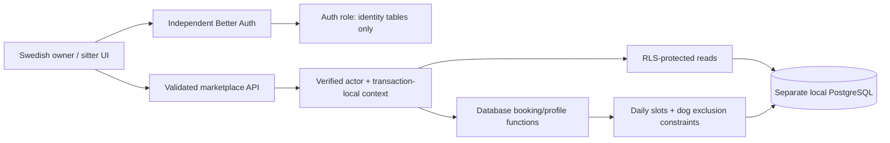

# Marketplace architecture

Status: local functional prototype, 7 November 2026. No production rollout. Feature branch `codex/marketplace-foundation` is based on the sanitized public release `7b9dadb`, not the private installation's history.

## Decision: separate application and database

The single-sitter app's identity is owner-account-as-dog; its administrator intentionally sees every booking and its singleton windows/availability are global. Retrofitting tenant IDs would require auditing all booking, reminder, invitation, notification and shared-calendar queries and would create a dangerous partial-migration state.

`marketplace/` is a separate Next.js application and local PostgreSQL database. It shares only locked npm dependencies, the pure Stockholm date helper and hydration hook. The standalone `src/`, SQL migrations, routes and services are unchanged. Root TypeScript excludes the new app; ESLint ignores its generated files. Separate auth cookies and origins prevent accidental session reuse.

Trade-off: duplicated auth configuration and UI styling, and SQL/TypeScript validation that needs parity tests. This is smaller and safer than a tenant retrofit or premature shared domain package. A later standalone-to-marketplace import needs consent, dog mapping and new account activation; no automatic import is provided. See [ADR 001](marketplace/docs/adr-001-separate-application.md).

## Model and isolation

| Table                                                     | Ownership and privacy                                                                                                                                     |
| --------------------------------------------------------- | --------------------------------------------------------------------------------------------------------------------------------------------------------- |
| `user`, `session`, `account`, `verification`, `rateLimit` | Better Auth identity; separate auth role; not accessible to domain runtime                                                                                |
| `sitters`                                                 | One operator per sitter tenant in this slice; a user may also own dogs. Only that operator reads the base row. Search uses a minimized public projection. |
| `dogs`                                                    | Many per owner; owner-only RLS. Size, integer age, optional breed, explicit sociability, required care, preferences and private notes.                    |
| `availability`                                            | Explicit open dates per sitter. Only the operator reads the full schedule. Search gets eligibility booleans, not other guests or reservation counts.      |
| `bookings`                                                | Owner + sitter relationship, inclusive dates, immutable price and retry payload, status/revision. Only parties can read.                                  |
| `booking_dogs`                                            | Composite owner/dog and booking/sitter/owner foreign keys; immutable care snapshot and global active-dog overlap exclusion.                               |
| `reservations`                                            | Daily capacity slots; active sitter/slot/date overlap exclusion. No runtime read/write access.                                                            |

The domain role `marketplace_app` is neither owner, superuser nor BYPASSRLS and cannot write tables, read auth tables, assume the auth role or create schema objects. RLS protects private reads. Each request sets the verified UUID with transaction-local `set_config`; commit/rollback clears it before the pooled connection is returned. IDs sent by a browser never establish ownership. There is no global administrator bypass.

Writes use explicitly granted `SECURITY DEFINER` functions, owned by the local migration administrator. Their fixed `search_path`, bound arguments, actor checks and restricted grants are part of the security boundary. Table-owner bypass is intentional inside these functions; RLS is not claimed to sandbox the migration administrator or a compromised application holding both credentials. Production requires separate protected migration credentials, audited operator access, secret rotation and independent database-role review. Do not enable ordinary owner/admin credentials for runtime.

Search has no owner identifiers, email, private notes, booking IDs or exact home addresses. Coarse points are stored with two decimal places; distance is approximate straight-line distance. Care snapshots are shared with the chosen sitter when a request is submitted, as explained in the UI. Sitter care access ends on decline/cancellation or after the final Stockholm date; owners retain their snapshots. Search never reads the notes for scoring. Owners should not put human medical or contact information in notes. Retention/deletion is a launch gate.

## Reservation rules

- Boarding only, SEK integer öre per dog per inclusive calendar day, `Europe/Stockholm`. One-day stays consume one day. Maximum 31 days and one-year horizon. These demo charging semantics are not a commercial policy.
- One booking can contain 1–5 distinct dogs owned by the caller. Global dog exclusion prevents an active dog staying with two sitters on intersecting inclusive dates.
- Pending and confirmed requests consume the same capacity. Decline/cancel releases all daily slots and active dog reservations atomically. Pending holds have no expiry yet; explicit decisions/cancellation are required.
- Social dogs consume one slot each per day. Any non-social dog requires no resident dogs and reserves all sitter slots for that household party. Within-party compatibility is assumed to be the owner's responsibility; unknown sociability is rejected. A pilot needs a fuller, reviewed safety checklist.
- Requests take an actor/key advisory lock, a sitter row lock, then dog share locks in UUID order. Each day allocates available slots separately. Unique/range exclusions remain a second concurrency barrier. Whole transactions roll back on any failing day.
- Date validity is checked before work, after row locks and after potentially waiting exclusion inserts, using the database clock in Stockholm. Cancellation/decision validates revision after locks. A race yields one legal state, not duplicate capacity.
- Request UUIDs are unique per owner; identical normalized payloads return the same booking, changed payloads conflict. Quoted daily price is checked and total calculated in SQL. Profile edits do not rewrite existing price or care snapshots.
- Sitter profile writes serialize even during first creation. Capacity, resident-dog, size and care-capability changes are blocked while future active commitments exist. Closing dates with active bookings is rejected. Published profiles belonging to inactive accounts cannot receive new requests.

## API contract

All endpoints are under `/api/marketplace/`. The API uses Better Auth sessions, active-user checks, strict Zod input, parameterized SQL, exact same-origin JSON for mutations, and `private, no-store` responses. Database errors are mapped to Swedish generic errors without query/credential exposure.

| Method / resource             | Result / authority                                                                                                          |
| ----------------------------- | --------------------------------------------------------------------------------------------------------------------------- |
| GET `me`, optional `?id=UUID` | Own dogs, own sitter profile/open dates, party bookings and permitted care snapshots; unrelated IDs return 404              |
| POST `dogs`                   | Create/update caller-owned dog; caller cannot set owner                                                                     |
| POST `sitter`                 | Create/update caller's sitter profile; caller cannot choose operator                                                        |
| POST `availability`           | Open/close caller's dates                                                                                                   |
| POST `search`                 | Dates, coarse point, owned dog UUIDs → matching version, ranked matches, scores/explanations, excluded profiles/reasons     |
| POST `bookings`               | Search input + sitter UUID + expected daily price + retry UUID → booking UUID                                               |
| POST `decisions`              | Booking UUID, expected revision, `confirmed`/`declined`/`cancelled`; only the sitter accepts/declines, either party cancels |

Service functions take verified actor IDs, not sessions or browser-supplied actor objects. Future adapters must authenticate separately and call this boundary; neither raw SQL nor a matching result authorizes a booking. A future reranker can reorder eligible match IDs only.

## Limits before a pilot

One operator per sitter and one guardian per dog; no household/staff invitations. Explicit dates instead of recurring schedules. Agenda capped at 200 bookings; no production pagination. Search scans all synthetic published profiles and is not a PostGIS-scale directory. No payment, messaging, outbox, automatic hold expiry, fraud controls, identity/permit verification, production recovery or operational monitoring. Coarse locations are self-entered. See [roadmap](MARKETPLACE_ROADMAP.md) for gates rather than treating these as launch-ready defaults.
