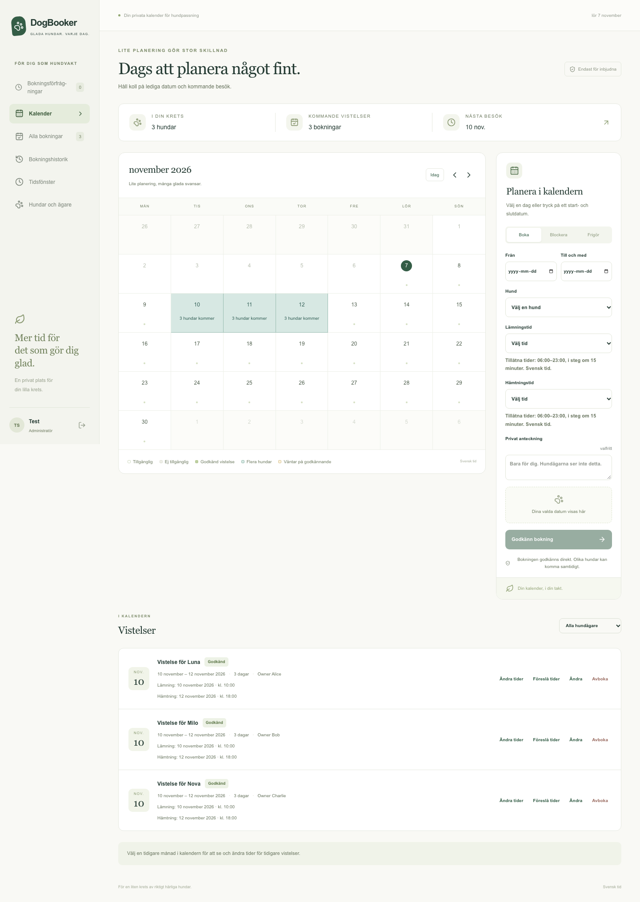
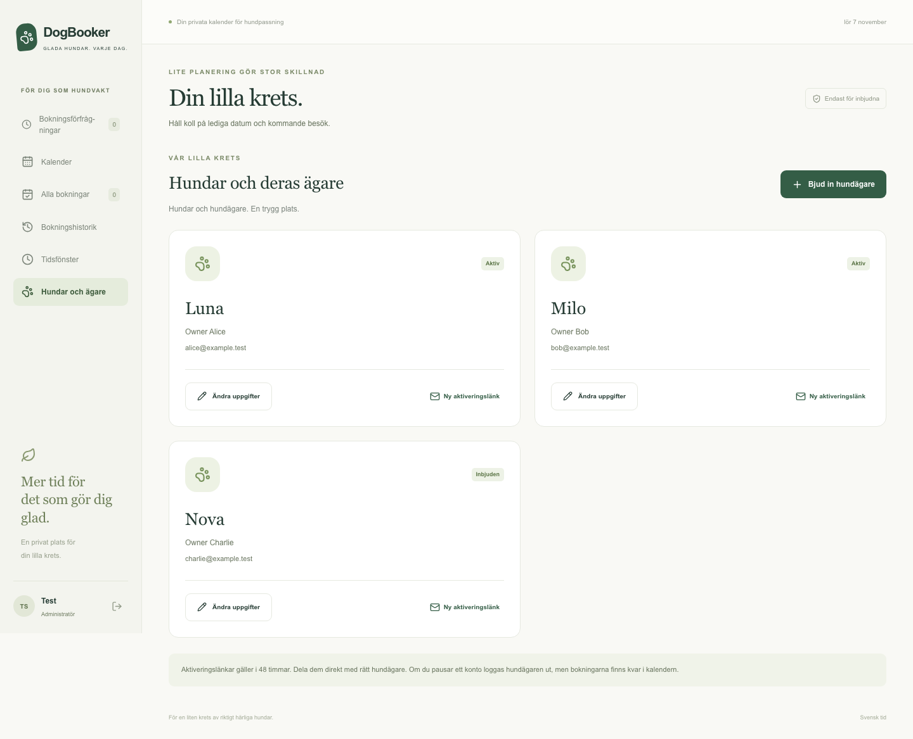

# DogBooker

An isolated, local-only [marketplace prototype](marketplace/README.md) is available on this feature branch. It has its own app, authentication and database; the standalone installation below remains independent.

A small, self-hosted dog-sitting calendar with a Swedish interface. Invite owners, accept booking requests, and coordinate drop-off and pickup times. Each installation has its own administrator, database, accounts and email credentials.




## What it does

- Configurable number of **owner/dog pairs**: one dog per owner account; `MAX_OWNERS=0` removes the account cap. Names and emails are entered by your administrator.
- Shared calendar, administrator date blocks, booking approval/decline, cancellation history and private notes.
- Different dogs can stay on the same dates. PostgreSQL rejects overlapping reservations for the same dog and conflicts with administrator blocks, including simultaneous requests.
- Configurable drop-off/pickup windows, date overrides, approved time-change proposals and separate missing-time reminders.
- Swedish text and Europe/Stockholm calendar/deadline semantics, including daylight-saving time.
- Invitation-only authentication, role checks, one-use invitation links, persistent email outbox and optional Gmail SMTP delivery.

This release is for one sitter/administrator per installation. The account limit is **not a daily boarding-capacity limit**: administrators approve the number of simultaneous dogs they can safely host. Multi-dog households, multiple sitters, discovery, reviews and payments belong to a separate future design.

## Quick start

Requirements: Node.js 22+, npm, and Docker Compose (or PostgreSQL 16+). No cloud account is required.

```sh
git clone https://github.com/vernerisirva/dogbooker.git
cd dogbooker
npm ci
npm run setup
docker compose --env-file .env.local up -d --wait
npm run db:migrate
npm run account:admin -- "Your name" you@example.com
npm run dev
```

Open <http://localhost:3000>. Privately open `.local/admin-invitation.txt`, follow the single-use link, choose a password, and sign in. Under **Hundar och ägare**, invite each owner with their dog name. Share activation links directly; they expire after 48 hours.

`npm run setup` generates unique local database/auth/cron secrets in ignored `.env.local` and refuses to overwrite an existing file. For an existing PostgreSQL server, edit both database URLs before migration. Use a **new empty database**, never another application's database.

## Try synthetic sample data

Only on a disposable local database: set `ALLOW_TEST_DATABASE=true` in `.env.local`, keep `TEST_DATABASE_HOST` equal to that database's hostname, and leave Gmail credentials empty. Do this **instead of creating a real administrator**.

```sh
npm run db:migrate
npm run db:seed
npm run dev
```

The seed replaces test fixtures, creates sample stays, and writes random passwords to ignored `.local/test-accounts.json`. It refuses databases with non-`example.test` accounts or outbound email credentials. Screenshots above use only these fictional fixtures. Reset `ALLOW_TEST_DATABASE=false` before real use.

## Checks

Use a separate disposable test database with the test settings above; browser tests start their own server on port 3000, which must be free.

```sh
npm run lint
npm run typecheck
npm test
npm run db:migrate
npm run test:integration
npm run build
npx playwright install chromium
npm run test:e2e
npm audit --audit-level=moderate
npm run licenses
```

CI repeats these checks with a fresh PostgreSQL service. Tests cover privacy, role/origin checks, one-use invitations, approvals, time windows, cancellations, concurrent reservations, notification retries, DST and Swedish desktop/mobile flows. See [release validation](docs/SECURITY_REVIEW.md).

## Operate your own installation

Read [deployment and email setup](docs/DEPLOYMENT.md) before hosting. For a Node server: `npm run build`, then `npm start`; run `npm run worker` every minute for queued mail and reminders. A separate Vercel project is another supported deployment option, with its own database and secrets.

- [Architecture and privacy boundaries](docs/ARCHITECTURE.md)
- [Configuration, backups, scheduler and deployment](docs/DEPLOYMENT.md)
- [Security policy](SECURITY.md) and [release review](docs/SECURITY_REVIEW.md)
- [Third-party license review](THIRD_PARTY_NOTICES.md) and [locked inventory](docs/dependencies.json)
- [Contributing](CONTRIBUTING.md)

## License

DogBooker source and its synthetic screenshots are [MIT licensed](LICENSE). Dependencies retain their own licenses; the inventory includes weak-copyleft native/build components. No database, credentials, invitation tokens, private deployment configuration or previous application history is distributed.
