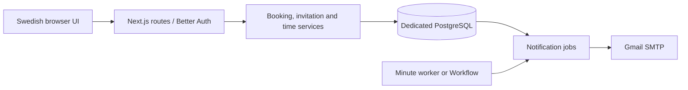

# Architecture

DogBooker is a single-installation Next.js App Router application. React renders the Swedish calendar and forms. Route handlers authenticate with Better Auth, read the current active user from PostgreSQL, check the origin on mutations, validate input with Zod, and call transaction-oriented services. SQL values are parameterized. Drizzle describes authentication/application tables; migration SQL owns constraints and triggers.

## Accounts and visibility

There is one administrator and any configured number of owner/dog pairs. An owner's stable UUID also identifies their dog for reservations; names are labels, never identifiers. `MAX_OWNERS=0` means no configured cap. A positive integer caps all owner accounts, including paused accounts, without deleting existing accounts when lowered. Concurrent invitations hold an advisory transaction lock before counting/inserting. Restart the server after changing configuration.

Owners see their own bookings and times. For another owner's confirmed stay, the server exposes only dates and dog name. It hides pending requests, IDs, owner names/emails, times and private notes. Explain this shared-calendar visibility to owners before onboarding. Administrators see/manage all records within their installation. Pausing a user revokes sessions; every authenticated request rechecks activity. Changing an email removes the old password credential and requires a fresh invitation. Invitations store SHA-256 token hashes, expire in 48 hours and are consumed under row locks. The raw token appears only in the URL fragment and private administrator file/UI.

## Booking correctness

Dates are inclusive. Pending and confirmed bookings reserve dates. The `dog_booking_scope` UUID range plus `daterange` GiST exclusion constraint rejects overlaps for the same dog; a block has an unbounded dog scope and conflicts with every dog, including future accounts. Independent dogs can overlap. The constraint arbitrates concurrent writes, including transactions at READ COMMITTED and REPEATABLE READ. Application checks improve error messages but do not replace the constraint.

Approvals and cancellations lock bookings. Dates/ownership/time changes use revisions and database triggers so stale proposals cannot overwrite current data. Administrators can block and partially unblock ranges. Owners can cancel future stays; ongoing/past stays require administrator help. Cancelled stays disappear from upcoming lists after 24 hours and remain in private history.

## Times and localization

All calendar deadlines use Europe/Stockholm. Dates are date values, arrival/pickup are local wall-clock times, and audit timestamps are timezone-aware. Defaults and date-specific windows validate requests. An owner may request drop-off changes through the first day and pickup changes through the last day; the server enforces deadlines. Administrator/owner proposals require the other side's decision. Existing effective times remain until approval.

Drop-off and pickup reminders are independent. At/after 09:00 Stockholm, two calendar days before the relevant date, the worker queues only missing/rejected times with no owner proposal awaiting approval. Eligibility is checked again under a booking lock immediately before submission. An offline worker does not send a stale reminder on a later date; monitor scheduler health.

## Notification outbox

Booking changes and notification jobs commit together. The worker claims jobs with `FOR UPDATE SKIP LOCKED`, a lease and a unique event/version key. It freezes content and commits an attempt marker before SMTP. Definite transient failures retry with backoff; an ambiguous timeout/crash becomes `needs_review` because SMTP cannot guarantee exactly-once delivery. A repeated worker must not blindly resend an uncertain job. Recipients are checked for activity and email changes before delivery. Mail contains an authenticated app link, never an invitation token or private notes.

The portable minute worker uses the same eligibility and outbox services as the optional Vercel Workflow scheduler. Two messages are processed per worker invocation; increase worker frequency or deliberately revise/test throughput before larger installations. This is a small-sitter application, not an unbounded-scale service.

## Source map

| Location | Responsibility |
| --- | --- |
| `src/app/api` | Authentication/authorization and HTTP validation |
| `src/lib/booking-service.ts` | Booking/calendar/privacy projections and transactions |
| `src/lib/arrival-service.ts`, `time-window-service.ts` | Revisions, proposals and permitted times |
| `src/lib/notifications.ts`, `mail-transport.ts` | Outbox delivery and SMTP uncertainty |
| `src/lib/reminder-*`, `src/workflows` | Eligibility and optional durable scheduling |
| `src/components` | Calendar, Swedish forms, owner/admin views |
| `drizzle` | Ordered checksummed SQL migrations |
| `scripts` | Local setup, migrations, samples, admin bootstrap and worker |

There is no shared cloud control plane or application telemetry. Each operator provisions their own database, credentials and backup policy. The future marketplace proposal is a separate artifact and adds no runtime code or migrations here.
